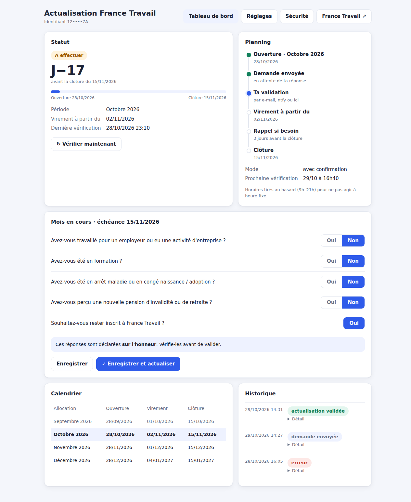
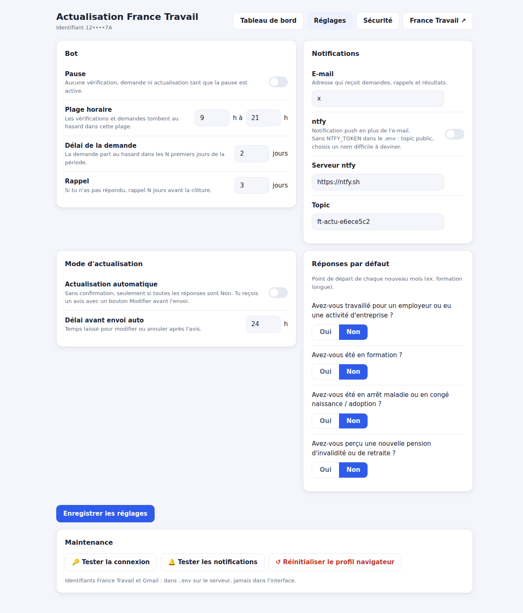
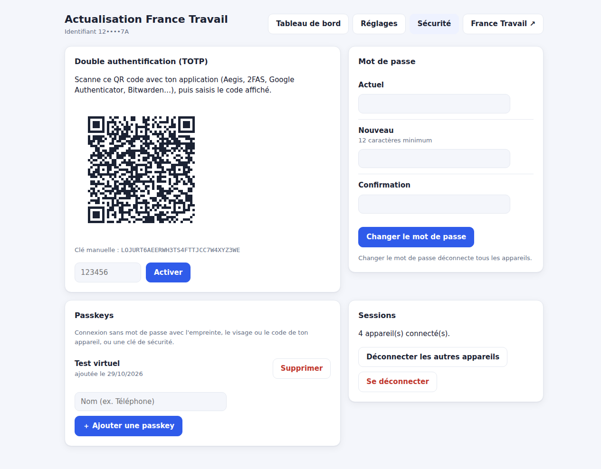
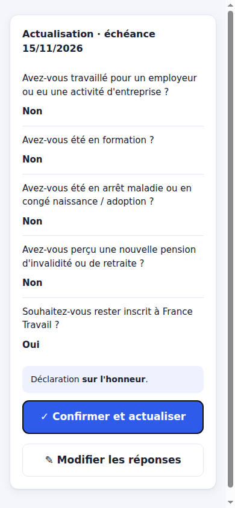
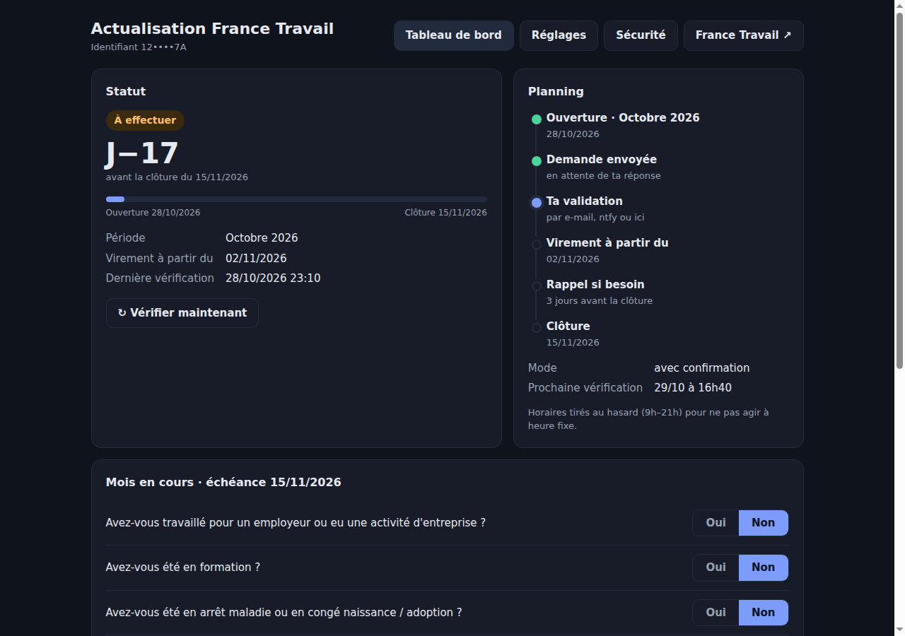

# Actualisation France Travail

[](https://github.com/molotovah/ft-actu/actions/workflows/docker.yml)

Un petit serveur auto-hébergé (Docker) qui s'occupe de ton **actualisation mensuelle France Travail** :
il surveille le calendrier, te demande confirmation au bon moment et remplit le formulaire à ta place.
Une interface web te montre où tu en es.



> [!WARNING]
> **Projet personnel, non officiel, sans lien avec France Travail.**
> L'actualisation est une **déclaration sur l'honneur** : tu restes responsable de ce qui est déclaré.
> Le bot ne sait déclarer qu'un mois **sans activité, formation, arrêt maladie ni nouvelle pension**
> (toutes les réponses à « Non »). Dès qu'une réponse est « Oui », il s'arrête et te renvoie vers francetravail.fr.
> Le site de France Travail peut changer à tout moment et casser l'automatisation : surveille les notifications.
> Utilisation à tes risques.

## Ce que ça fait

- **Suit ton statut** (« À effectuer », « Validée ») et le **calendrier officiel** des actualisations et des virements.
- **Te demande confirmation** à chaque période, par **e-mail** (boutons « OK, actualiser » et « Modifier »)
  et, si tu veux, par notification **ntfy** sur ton téléphone.
- **Actualise pour toi** une fois que tu as confirmé, puis t'envoie le résultat avec des captures d'écran
  du récapitulatif et de la confirmation.
- **Se comporte comme un humain** : horaires tirés au hasard chaque jour, demande dans les premiers jours de
  la période, petites pauses entre les clics.
- **Te relance** quelques jours avant la clôture si tu n'as pas répondu.
- **Mode automatique optionnel** : sans confirmation, avec un avis envoyé avant pour te laisser le temps de modifier.
- **Lit seul le code de connexion** envoyé par e-mail par France Travail (Gmail, via IMAP), et garde un
  navigateur « de confiance » pour ne pas le redemander à chaque fois.
- **Interface web sécurisée** : mot de passe, double authentification par QR code (TOTP), passkeys.

| Réglages | Sécurité | Confirmation (mobile) |
|---|---|---|
|  |  |  |

Thème sombre automatique :



## Comment ça se passe chaque mois

1. La période d'actualisation ouvre (en général le 28, voir le calendrier France Travail).
2. Dans les jours qui suivent, à une heure au hasard, tu reçois un e-mail (et une notification ntfy) avec
   les réponses prévues.
3. Tu cliques **OK, actualiser** puis tu confirmes, ou **Modifier** pour changer les réponses dans l'interface.
4. Le bot se connecte, remplit le formulaire, valide et t'envoie le résultat.
5. Si tu ne réponds pas, rappel quelques jours avant la clôture (le 15).

## Prérequis

- Un serveur avec **Docker** et **Docker Compose** (NAS, mini-PC, VPS…), environ 1 Go de RAM.
- Un **compte Gmail** qui est l'adresse e-mail de ton compte France Travail : c'est là qu'arrive le code
  de connexion.
- Un **mot de passe d'application Google** pour ce compte (il faut que la validation en deux étapes Google
  soit activée) : <https://myaccount.google.com/apppasswords>.
- Un **nom de domaine en HTTPS** devant l'interface (reverse proxy : Caddy, Traefik, Nginx Proxy Manager…).
  Les passkeys exigent HTTPS, et les liens des e-mails doivent être joignables depuis ton téléphone.

## Installation

```bash
git clone https://github.com/molotovah/ft-actu.git
cd ft-actu
cp .env.example .env
chmod 600 .env
nano .env          # remplis tes identifiants, l'adresse Gmail, le mot de passe d'application et BASE_URL
docker compose pull          # image prête (amd64 et arm64), ou `docker compose build` pour la construire
docker compose up -d
docker compose logs ft-actu
```

L'image est publiée sur `ghcr.io/molotovah/ft-actu` par GitHub Actions à chaque mise à jour de `main`
(`latest`) et pour chaque version `vX.Y.Z`. Mise à jour : `docker compose pull && docker compose up -d`.

Les logs affichent un **lien de première configuration** :

```
*** Première configuration : ouvre https://actu.example.org/setup?token=...
```

Ouvre-le, choisis le mot de passe de l'interface, puis va dans **Sécurité** pour activer la double
authentification (QR code) et/ou ajouter une passkey. Seule une personne qui a accès aux logs du container
peut faire cette première configuration.

Ensuite, dans **Réglages** → **Maintenance**, clique **Tester la connexion** : le bot se connecte à France
Travail (le premier coup, il lit le code reçu par e-mail) et récupère ton statut et le calendrier.

### Reverse proxy

Le container écoute sur le port `8080`, publié uniquement en local (`127.0.0.1:8080`) par `compose.yml`.
Exemple Caddy :

```
actu.example.org {
    reverse_proxy 127.0.0.1:8080
}
```

`BASE_URL` dans `.env` doit être exactement l'adresse publique (par ex. `https://actu.example.org`).

## Configuration

### `.env` (secrets, jamais affichés dans l'interface)

| Variable | Rôle |
|---|---|
| `FT_ID`, `FT_PASSWORD` | Identifiant et mot de passe France Travail |
| `GMAIL_USER` | Adresse Gmail du compte France Travail |
| `GMAIL_APP_PASSWORD` | Mot de passe d'application Google (lecture du code + envoi des notifications) |
| `BASE_URL` | Adresse publique HTTPS de l'interface |
| `AUTH_MODE` | `builtin` (défaut) ou `proxy` (voir Sécurité) |
| `NTFY_TOKEN` | Optionnel : jeton si ton serveur ntfy exige une authentification |

### Page Réglages

- **Pause** du bot.
- **Plage horaire** des vérifications et des demandes.
- **Délai de la demande** (dans les N premiers jours de la période) et **rappel** (N jours avant la clôture).
- **Mode automatique** et délai avant envoi.
- **Réponses par défaut** de chaque nouveau mois.
- **Notifications** : adresse e-mail de réception, ntfy (serveur et topic).
- **Maintenance** : tester la connexion, tester les notifications, réinitialiser le profil navigateur.

### Notifications ntfy

Active ntfy dans les réglages, puis abonne-toi au même topic dans l'application ntfy
([Android](https://play.google.com/store/apps/details?id=io.heckel.ntfy), [iOS](https://apps.apple.com/app/ntfy/id1625396347)).
Sur le serveur public `ntfy.sh`, n'importe qui connaissant le nom du topic peut le lire : garde le nom
aléatoire proposé, ou utilise ton propre serveur ntfy avec un jeton (`NTFY_TOKEN`).

## Sécurité

- **Authentification intégrée** (`AUTH_MODE=builtin`) :
  - mot de passe haché avec scrypt (12 caractères minimum) ;
  - double authentification TOTP (QR code, compatible Aegis, 2FAS, Google Authenticator, Bitwarden…),
    un code ne peut pas être réutilisé ;
  - passkeys (WebAuthn) : empreinte, visage, code de l'appareil ou clé de sécurité ;
  - sessions dans un cookie `HttpOnly`, `SameSite=Strict`, `Secure`, seule leur empreinte est stockée ;
    expiration après 7 jours d'inactivité et 30 jours maximum ;
  - blocage de 15 minutes après plusieurs échecs de connexion ;
  - protection CSRF (vérification de l'origine) et en-têtes de sécurité (CSP stricte, anti-iframe…).
- **Lien de confirmation** des e-mails : jeton aléatoire à usage unique, et l'action se fait par un bouton
  (une simple ouverture du lien, par un antivirus de messagerie par exemple, ne déclenche rien).
- **Mode proxy** (`AUTH_MODE=proxy`) : à n'utiliser que si un reverse proxy authentifiant (Authelia,
  Authentik…) protège **déjà** toute l'interface, en laissant passer `/confirm` (protégé par son jeton).
  Exemple de règles Authelia :

  ```yaml
  - domain: 'actu.example.org'
    resources: ['^/confirm([?].*)?$']
    policy: 'bypass'
  - domain: 'actu.example.org'
    policy: 'two_factor'
  ```
- **Données** : tout est dans `./data` (statut, historique, captures, réglages, comptes d'accès, profil du
  navigateur). Les captures d'écran contiennent des informations personnelles : protège ce dossier et tes
  sauvegardes.

### Accès perdu

```bash
docker exec ft-actu python auth.py reset
docker compose restart ft-actu
docker compose logs ft-actu     # nouveau lien de configuration
```

## Dépannage

| Problème | Piste |
|---|---|
| « code e-mail France Travail non reçu » | Vérifie `GMAIL_USER`, le mot de passe d'application et que le code arrive bien dans la boîte de réception Gmail (pas un autre libellé). |
| Erreur à une étape du formulaire | Le site a peut-être changé. Regarde la capture « erreur » dans l'historique et ouvre une issue. |
| Le code est redemandé à chaque connexion | Normal après une réinitialisation du profil ; ensuite France Travail fait confiance au navigateur environ 3 mois. |
| Pas de notification ntfy | Réglages → Tester les notifications ; derrière Cloudflare, utilise l'URL interne Docker de ntfy. |

## Limites

- Uniquement les mois sans activité, formation, arrêt ni nouvelle pension.
- Uniquement Gmail pour la lecture du code de connexion.
- Un seul compte France Travail par container.

## Développement

```bash
python -m venv .venv && .venv/bin/pip install playwright==1.64.0 webauthn==3.0.1 segno==1.6.6
.venv/bin/python test_app.py
```

- `app.py` : connexion, lecture du statut et du calendrier, remplissage du formulaire, planification.
- `web.py` : interface web, e-mails.
- `auth.py` : mot de passe, TOTP, passkeys, sessions.
- `STEPS.md` : parcours du site France Travail et sélecteurs utilisés.

## Licence

[MIT](LICENSE)
